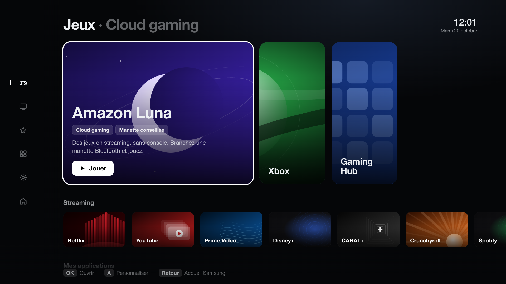

# TV Hub

**English** · [Français](README.fr.md)

A minimal personal launcher for a **Samsung QE55Q70BATXXC (2022 QLED)** TV, firmware
**T-PTMDEUC-1720.7**, running **Tizen 6.5** (Chromium M85 web engine).

**"Console"** style: an icon rail on the left, a large **games carousel** whose selected
card expands (Luna, Xbox, Gaming Hub), and carousels for **Streaming**, **My apps**
(favorites), **All apps** and **TV Hub settings**. Every known service gets an original
abstract illustration (no official logos). Fully remote-controlled, and kept light for
the TV's ARM processor (no full-screen animated layers).



> **Status: prototype tested in simulation, not yet installed on the TV.**
> Nothing has been connected to or installed on the TV yet. See [Installation](docs/INSTALLATION.md).

## Principles

- Standard Tizen web app (`.wgt`) using **public** privileges only.
- No network access (no `access` element, CSP `connect-src 'none'`), no account, no
  analytics, no telemetry. Preferences are stored locally inside the app.
- **No hard-coded app IDs.** Installed apps are discovered at startup
  (`tizen.application.getAppsInfo`) and matched by **name**. A tile can only be launched
  if the app was actually found on the TV.
- A missing service is shown as "Non détectée" (not detected) and explains how to reach
  it; it never fakes a launch.
- Does not replace the Samsung home screen, does not auto-start, changes nothing else on
  the TV. The remote's **Home** button always returns to the Samsung home screen.

> The on-screen interface and the documents in `docs/` are in French.

## Remote control

| Key | Browsing | Customizing |
|---|---|---|
| Arrows | Move focus; ← at a row's left edge opens the **rail** | Same / move the grabbed tile |
| OK | Open the app | Options: Move, Add/Remove favorite |
| Red (A) | Enter customizing mode | Done |
| Back | Return to the Samsung home screen | Done / close |

- **Carousels**: moving right slides the first cards out to the left to reveal the next
  ones; the neighbouring card always peeks in.
- **Rail**: ↑/↓ previews a section (the page scrolls), → or OK enters it. The last icon
  (house) returns to the Samsung home screen.
- **TV Hub settings**: Customize, **Service status** (what was detected, with the real
  app IDs), Samsung home, Reset (clears TV Hub's own preferences only).

## Layout

```
app/                 code packaged into the .wgt (and nothing else)
  config.xml         Tizen manifest (tv-samsung profile, 3 public privileges)
  index.html, css/, js/, img/, icon.png
dev/                 Tizen simulation + end-to-end test (never packaged, generated page)
maquettes/           the 4 UI mockups (design reference)
scripts/build.sh     tests + .wgt package (signed when Tizen Studio + a profile are available)
scripts/serve.sh     local preview at http://localhost:8765/dev/
scripts/capture.sh   1920×1080 screenshot of a state (key sequence ?keys=L,D,OK…)
tests/run-tests.js   unit tests and static checks (Node, no dependencies)
docs/                compatibility, installation, tests, startup, uninstall (in French)
```

## Quick start (on the Mac)

Requirements: Node.js and Python 3 (no npm dependencies).

```bash
./scripts/build.sh
```

```bash
./scripts/serve.sh
```

Then open `http://localhost:8765/dev/?fresh=1` and use the arrows, Enter, and Esc
(= Back). The 1920×1080 screen scales down to fit smaller windows.
Scenarios: `?scenario=full`, `?scenario=listfail`, `?scenario=notizen`.
Automated test: `?e2e=1`, then read `window.__e2e` in the console.
**The `dev/` page uses fictional apps**; it does not reflect your TV.

## Installing on the TV

Summary (full steps in [docs/INSTALLATION.md](docs/INSTALLATION.md), in French):

1. Install **Tizen Studio 6.1** (`web-ide_Tizen_Studio_6.1_macos-64.dmg` from
   `download.tizen.org`), then in the Package Manager install **TV Extensions** and
   **Samsung Certificate Extension** (≥ 2.0.73).
2. Turn on the TV's **Developer mode** (Apps → `12345`).
3. Create a **Samsung certificate** (Certificate Manager, Samsung account).
4. `TIZEN_PROFILE=<profile> ./scripts/build.sh`, then install the signed `.wgt`.

## Documents (French)

- [Compatibility and research](docs/COMPATIBILITE.md) — Luna / Xbox / other apps matrix, sources
- [Installation](docs/INSTALLATION.md) — Tizen Studio, Samsung certificate, deployment
- [Test report](docs/RAPPORT-DE-TESTS.md) — verified vs. not verified
- [Auto-start](docs/DEMARRAGE.md) — what is and isn't possible
- [Uninstall](docs/DESINSTALLATION.md)
