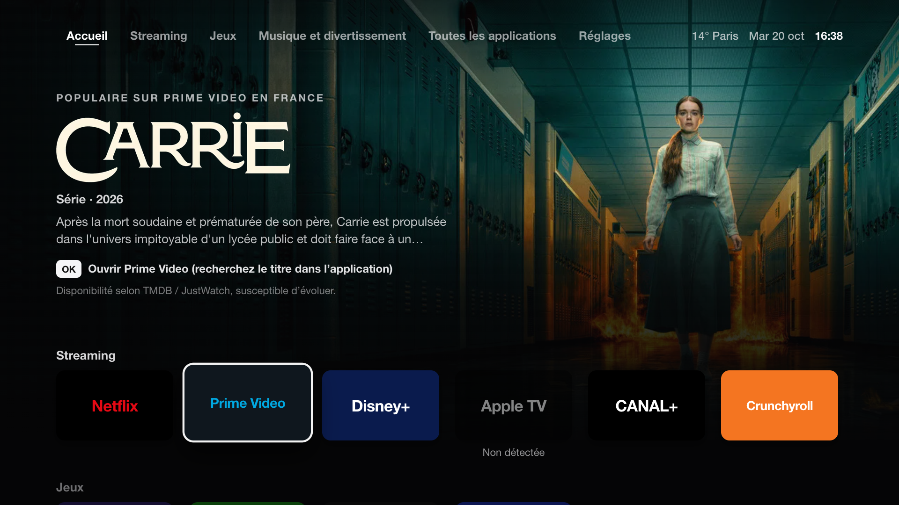
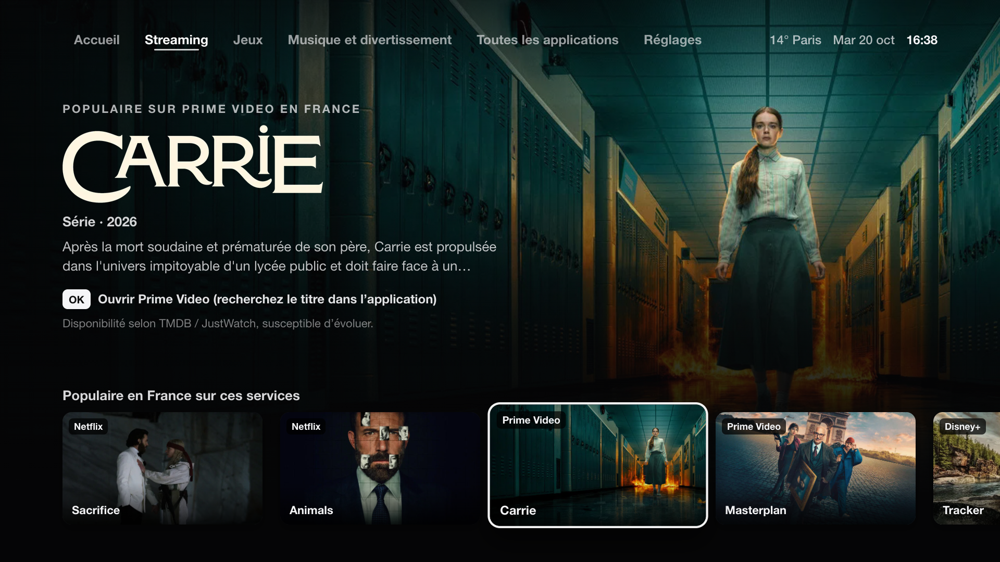
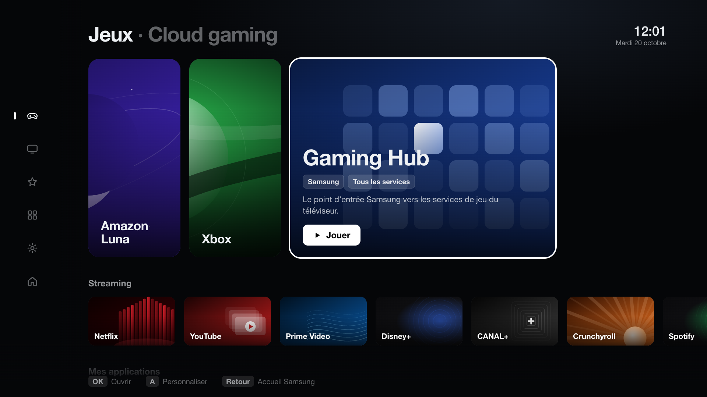
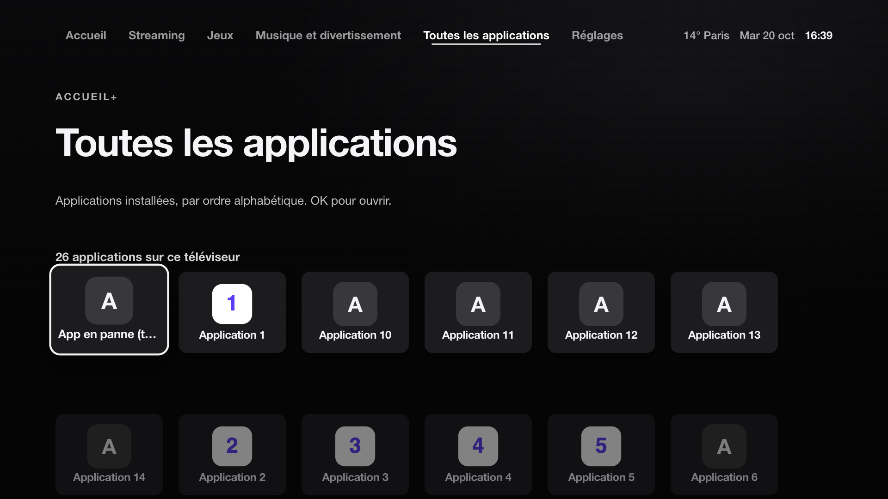
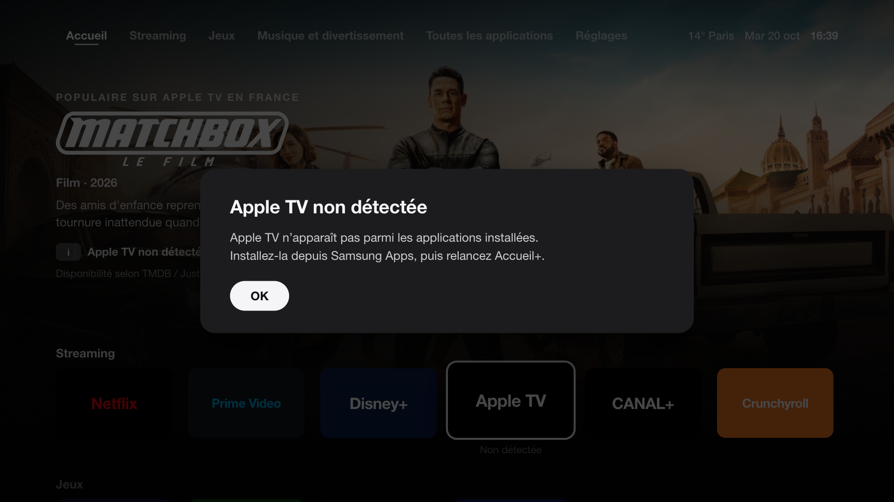
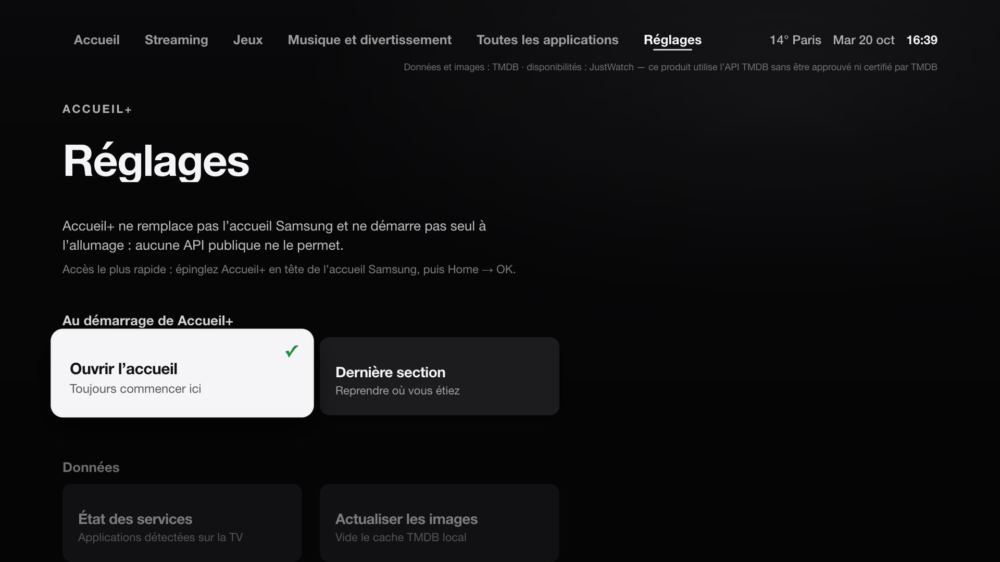

# Accueil+

**English** · [Français](README.fr.md)

A personal, Apple TV–inspired home screen for **Samsung (Tizen)** and **LG (webOS)** TVs.
All your streaming, cloud gaming and music services in one place, driven entirely with the
remote. Built and tested on a Samsung QE55Q70BATXXC (2022).



> **Installed and running on a Samsung QE55Q70BATXXC** (version 2.0.0). Screenshots come from
> the desktop simulation, with fake apps. The interface itself is in French.

## Supported TVs

| TV | Status | App detection | Install |
|---|---|---|---|
| Samsung 2022 (Tizen 6.5) | ✅ tested on the TV | by name, complete | `./scripts/install.sh` |
| Samsung 2017–2021, 2023+ (Tizen 3+) | intended, untested | by name, complete | `./scripts/install.sh` |
| LG (webOS 3+) | intended, tested in simulation | by name if the TV allows it, otherwise 6 major apps checked at launch | `./scripts/install-lg.sh` |
| Android TV, Google TV, Fire TV, Roku, Apple TV | not supported | — | — |

The platform is detected automatically: one codebase, one `app/` folder.

## What it does

- **Cinematic spotlight**: the selected tile shows a title that is popular on that service
  in France (backdrop, logo, year, synopsis), via TMDB.
- **Real launching**: apps are detected on the TV by name. A tile only opens an app that
  actually exists; otherwise it says "Non détectée" (not detected) and explains how to reach
  it. Launches are never faked.
- **Games**: a **▶ Reprendre** (resume) tile for the last game service you opened, and a
  **Jeu du moment** (current game) you type yourself, shown as a reminder.
- **All apps** installed on the TV, alphabetically.
- **Settings**: start on Home or on the last section, service status, image refresh.
- Discreet time, date and weather (Open-Meteo); "weather unavailable" rather than made-up values.

| Streaming | Games |
|---|---|
|  |  |
| **All apps** | **Service not detected** |
|  |  |



## Remote

| Key | Action |
|---|---|
| ← → | Neighbouring tile (stops at the edges); in the tab bar: neighbouring tab |
| ↑ ↓ | Neighbouring row, column remembered; ↑ from the first row → tabs; ↓ on a tab → opens it |
| OK | The only key that acts: opens the app, section or option (one launch at a time) |
| Back | Closes the dialog → previous section (position restored) → tabs → Samsung home |

## Honest limitations

- **No auto-start**: no public API lets an app launch at power-on or replace the Samsung
  home. Fastest path: pin Accueil+ first on the Samsung home, then Home → OK. See
  [DEMARRAGE.md](docs/DEMARRAGE.md) (French).
- **No deep links to a film or a game**: OK opens the service's app, you pick the content
  there (stated on screen).
- **Availability** comes from TMDB / JustWatch and may change.
- No official logos are bundled: tiles show the service name in its colours.

## Privacy and security

- Samsung: **public** Tizen privileges only. LG: public Application Manager service. Everywhere: no account, no telemetry, no ads.
- Network limited to **Open-Meteo** (weather) and **TMDB** (titles and images), enforced in
  `config.xml` and the CSP.
- Preferences are stored on the TV only.
- The TMDB key lives in `app/js/config.local.js`, **ignored by git**:
  `window.TMDB_KEY = 'your_key';`. Without it, the app works without images.

## Layout

```
app/            code packaged into the .wgt
  config.xml    Samsung (Tizen) manifest
  appinfo.json  LG (webOS) manifest
  index.html, css/hub.css
  js/hub.js     UI, focus, launching, settings
  js/tmdb.js    TMDB (6 h cache, 8 s timeout, error handling)
  js/platform.js  Samsung / LG / browser, detected automatically
  js/catalog.js, nav.js, store.js, widgets.js
dev/            Tizen simulation and end-to-end test (never packaged)
maquettes/      design mockups (v6 = basis of the current UI)
scripts/        build, local server, screenshots
tests/          dependency-free Node tests
docs/           installation, startup, compatibility, uninstall (French)
```

## Develop on the Mac

Requirements: Node.js and Python 3 (no npm dependencies).

```bash
./scripts/serve.sh
```

Then open `http://localhost:8765/dev/?fresh=1` (arrows, Enter, Esc = Back).
Samsung scenarios: `?scenario=full`, `?scenario=listfail`, `?scenario=notizen`.
LG scenarios: `?platform=webos` (app list denied), `?platform=webos&lglist=1` (list allowed).
Automated test: `?e2e=1`, results in `window.__e2e`.

```bash
node tests/run-tests.js
```

## Install on the TV

### Samsung

One command (tests, signed package, install, launch). The IP is remembered, so next
time `./scripts/install.sh` is enough.

```bash
./scripts/install.sh 192.168.1.123
```

First-time setup (developer mode, Samsung certificate): [INSTALLATION.md](docs/INSTALLATION.md).

### LG

```bash
./scripts/install-lg.sh
```

First-time setup (Developer Mode app, webOS CLI): [INSTALLATION-LG.md](docs/INSTALLATION-LG.md) (French).
Uninstall: [DESINSTALLATION.md](docs/DESINSTALLATION.md).

---

Data and images: [TMDB](https://www.themoviedb.org). Availability: JustWatch.
This product uses the TMDB API but is not endorsed or certified by TMDB.
